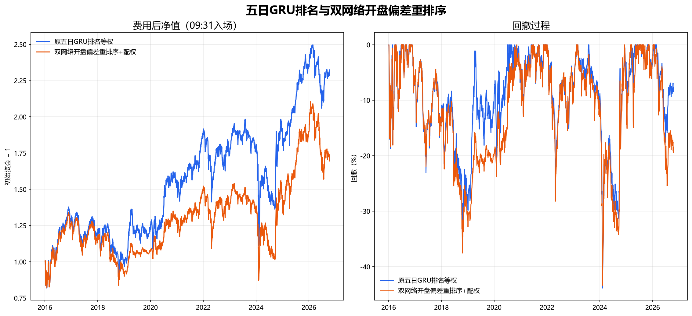

# 基于gru的全A排序排序尝试

这是我们最初的“双网络＋开盘重定价”研究版本，只保留三项核心内容：

1. **五日收益率排序 GRU**：用过去 40 个交易日的日线量价和换手率序列，对全 A 股下一开盘至第六个开盘的五日收益做横截面排序。
2. **次日跳开预测 GRU**：预测次日开盘相对当日收盘的隔夜收益均值和条件方差，并据此得到模型隐含开盘价。
3. **开盘偏差重排序策略**：次日开盘已知后，比较实际开盘与模型隐含开盘，估计原五日排序信号还剩多少收益空间，再按风险收益分重新选股和分配资金。

仓库不包含后来测试的 Qlib、HIST、LSR-IGRU 或 Markowitz 对照方案。

## 两个网络

五日排序网络输入为 `40 × 20`：10 个因果日线特征及对应的有效性标记。目标是

```text
adjusted_open[t+6] / adjusted_open[t+1] - 1
```

每日把目标转成横截面秩并缩放到 `[-1, 1]`，使用相关系数损失训练。

跳开网络输入为 `40 × 32`：在上述特征上增加 5/20 日累计隔夜收益、20 日隔夜波动、60 日隔夜异常值、隔夜与日内收益乘积、20 日隔夜与日内相关性，以及对应的缺失标记。目标是

```text
adjusted_open[t+1] / adjusted_close[t] - 1
```

网络同时输出条件均值和方差，使用高斯负对数似然训练。两个 GRU 参数完全独立。

每个测试年只使用此前三个自然年：前 2.5 年拟合，最后六个月选择训练轮数；随后重新初始化，并在完整三年上按选定轮数重训。所有训练和校准标签都必须在测试年开始前成熟。

## 开盘后的重排序

当 `t+1` 的实际开盘已知时，计算开盘折价：

```text
discount = clip((1 + predicted_gap) / (1 + actual_gap) - 1, -5%, 5%)
```

`discount > 0` 表示实际开盘低于模型隐含开盘。策略只用此前三个完整年度、已经成熟的样本，在原五日排序的每个十分位内估计：

```text
expected_remaining_return
  = historical_mean_return
  + shrunk_beta × (discount - historical_mean_discount)

risk_return_score
  = (expected_remaining_return - round_trip_cost)
  / shrunk_residual_variance
```

条件方差按“原排序十分位 × 开盘异常幅度区间”估计，并向该十分位的残差方差收缩。每天最多选择全股票池的前 10%，只保留正分股票；权重与风险收益分成比例，单只股票在每个五日轮换资金批次中不超过 1%，无法分配的部分保留现金。

## 回测结果

回测区间为 2016-01-05 至 2026-10-16，信号在次日正式开盘后形成，以 09:31 成交近似，五个资金批次滚动持有至 `t+6` 开盘。基础费用为买卖各 8 个基点，并计入卖出印花税。

| 方法 | 累计收益 | 年化收益 | Sharpe（现金收益 0） | 最大回撤 |
|---|---:|---:|---:|---:|
| 原五日 GRU 排名等权 | 128.60% | 8.29% | 0.459 | -43.85% |
| 双网络开盘偏差重排序＋配权 | 69.54% | 5.22% | 0.334 | -43.37% |



这次历史检验中，开盘偏差重排序没有超过原五日 GRU 排名：年化收益下降，最大回撤仅小幅改善。仓库公开这个结果是为了完整记录策略假设及其失败边界，而不是把它包装成已经验证的超额收益方法。

## 文件

- `src/models.py`：两个原始 GRU 及各自损失函数。
- `src/train.py`：训练轮次与隔夜分布校准的最小实现。
- `src/strategy.py`：开盘折价、历史校准、风险收益评分与限权分配。
- `config.json`：冻结的研究口径。
- `results/metrics.csv`：本策略与原 GRU 对照的费用后汇总。
- `results/net_value_drawdown.png`：费用后净值与回撤。

原始行情、分钟数据、训练权重、逐股预测、逐日持仓和订单没有发布。代码需要使用者自行准备同口径的点时数据。

## 限制

- 历史区间已经被反复研究，不是新的未来盲测。
- 09:31 成交价是分钟线近似，没有模拟盘口队列、容量、整手和最低佣金。
- 开盘低于预测价可能来自新的负面信息，不能自动解释为错误定价。
- 数据供应商的历史修订和退市股票覆盖可能影响结果。

本仓库只用于研究复核，不构成投资建议。


